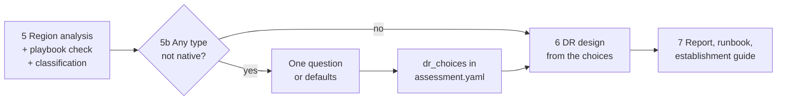

# Azure DR assessment skill v3: service playbooks, the DR options interview and the establishment guide

| | |
|---|---|
| Status | Approved design. This write-up awaits the owner's review. |
| Date | 2026-11-09 |
| Repository | `zenosoftorg/azure-dr-assessment` |
| Builds on | v2 as merged on `main`: spec `2026-11-04-azure-dr-skill-design.md` (cited as v2 §n) and contracts `2026-11-04-dr-skill-contracts.md`, a planning document kept outside this repository (cited as C §n, GC-nn, Dnn) |

## 1. Goal and scope

v2 tells a team whether its workload can recover in a chosen DR region and draws the target. Most teams that use the skill (about 90 % in the owner's estimate) run today with DR into the primary's Azure pair and move to a DR region that is not the pair. v3 makes that move the centre of the output: per service, how to establish DR in the new region, how to prove it works, and how to retire the paired setup.

Three additions carry it:

- **Service playbooks.** Curated, Learn-cited, per-service know-how in the repository: mechanisms, constraints, ranked non-paired options, the migration from a paired setup, failover and failback, and test criteria.
- **The DR options interview.** After the region analysis, one question lists every service with no native DR into the DR region, with its options and a recommended choice. Answers are saved in `assessment.yaml`.
- **The DR establishment guide.** A new main deliverable, `reports/dr-establishment-guide.md`: one chapter per service, from today's paired setup to a validated DR in the new region, with measurable test criteria. The runbook gains per-service procedures, and presentation 2 gains a chapter.

**Success checks the plans must prove**

1. A run with a non-paired DR region produces the guide with one chapter per in-scope service, in build order, each with today's setup, the target, build, validate (measurable test criteria), cut-over and decommission steps.
2. Every service without native DR into the DR region appears in exactly one interview question with its options and a marked recommendation; a rerun asks nothing about a recorded type.
3. A split-region choice draws a third region group with the cross-region dependency, and the residency check is visible.
4. Every playbook claim that bears on classification is checked against Learn in the run; a disagreement is reported and Learn wins.
5. v2's success checks (v2 §1) still hold: nothing writes to Azure, nothing writes into the skill directory, company patterns still outrank Learn.

## 2. Confirmed decisions

| # | Decision | Where |
|---|---|---|
| 1 | **Interview** during the run, after the region analysis: one question listing every service with no native DR into the DR region, with options and a recommended choice. Answers are saved in `assessment.yaml` (`dr_choices`), so a rerun never asks again. With nobody to answer, the run takes the recommendation and lists it as an open decision. | §5.2, §7 |
| 2 | The per-service establishment guide is a **migration from the existing paired setup**: today's DR from the inventory, the target in the new DR region, and the transition: build, validate, cut over, decommission the old paired setup. | §8.1 |
| 3 | **Commands are not given by default** (as in v2). When the user asks for commands, the skill first asks which form: Azure CLI, Bicep, Terraform, Azure PowerShell or portal steps. Always labelled untested. The runbook and the guide give concrete prose procedures. | §8.6 |
| 4 | **Split-region fallback** (one service recovers into its own pair while the rest goes to the DR region) is one of the interview options, decided case by case. No company pattern governs it. | §7.2, §5.3 |
| 5 | **Knowledge sources, three layers combined:** company patterns outrank; curated service playbooks in the repository are the default source for workarounds, setup steps and test criteria; Learn read in the run covers services without a playbook and verifies every playbook claim. | §4, §6 |

Everything else records the four-part design the owner approved: flow and precedence; service playbooks; interview and design choices; deliverables, testing and staging. Where the approval left a detail open, this spec states one reading and lists it in §12.1.

## 3. Changes to v2

### 3.1 What stays

Stages 1 to 4; the tier gate and DR-TIER-001; company patterns, overrides and their levels (v2 §6, C §7.6); the ledger and its labels (GC-12, extended in §3.2); read-only Azure (GC-06); no secrets (GC-07); outputs only below `dr-assessment/{app}/` (GC-09); the report's sections 1 to 7 and A to D; the DRAFT runbook; the pack banner; degraded modes; no prices; no "achieved" without a drill record.

### 3.2 What changes

| v2 reference | v3 change |
|---|---|
| v2 §6.2, GC-11, `SKILL.md` "Precedence" | Five ranks instead of four: the service playbook sits between the company pattern and Learn (§4). |
| v2 §4 "One shot"; `SKILL.md` "Run the stages in order, in one pass" | One more stop: stage 5b asks the DR options question once, only when a service is not native, and never when nobody can answer (§5.2). |
| v2 §7 step 6, stage 5 step 6 (substitutes: pattern, customer-built, unmet) | The substitute order becomes the option list of a type: a pattern still governs where it decides the slot; otherwise the options come from the playbook, else from Learn, and the owner chooses (§7). `unmet` stays for a type whose only option is accepting the gap. |
| v2 §7 bullet "Paired-only mechanisms" | Unchanged as a rule: a paired-only mechanism never counts as coverage in the DR region. A split-region choice uses it knowingly, draws the replica's region as a third region and labels it (§5.3). |
| C §7.1 `assessment.yaml` | New list field `dr_choices` after `decisions` (§7.4); it joins the list fields that `readAssessment` refuses when they are not a list. |
| C §7.3 ledger | Two new region checks: `option` (a Learn-derived option for a type without a playbook) and `playbook-claim` (a playbook constraint checked against Learn, with `agrees` true or false). Classification is not a ledger entry; it lives in the new derived file `evidence/dr-options.json` (§7.1), which cites ledger ids. |
| C §7.4 diagram, `diagram-style.mjs` | New group style `split` for `proposed-dr` (§5.3). |
| C §7.5 story contract (nine steps) | Ten step ids: `establishing` between `healthy` and `disaster`, with one or more scenes (§8.3). |
| C §7.6 resolution | Decision source `playbook` is allowed where the candidate is `learn`; a new `documentedExceptions` kind `dr-choice-gap` (§7.5). D28 holds: an override without an `alternative` keeps the source `override`, and its content may now come from the playbook. |
| C §5 script catalog | Three new scripts: `lint-playbooks`, `dr-options`, `establishment-guide` (§3.3). |
| D17 (a rerun of `ingest` replaces the ledger) | Unchanged. `dr_choices` live in `assessment.yaml`, so they survive it. |
| GC-07 secret seams | Two more: `dr-options --record` (the text it writes into `assessment.yaml`) and `establishment-guide` (every string it writes). Both refuse with exit 2 and name the path, never the value. |
| GC-09 refusals | `dr-options` and `establishment-guide` exit 4 when an output path is inside the skill or plugin directory. |
| GC-10 | Playbooks come only from the bundled `playbooks/` folder; `DR_PLAYBOOKS_DIR` or `--playbooks-dir` is a test and operator hook (§6.2). |
| GC-12 labels | New set **DR path**: Native, Workaround, Split-region, Backup-restore, No path. New choice marks: Recommended, Default (chosen by nobody). |
| v2 §9, output contract | New file `reports/dr-establishment-guide.md` and derived file `evidence/dr-options.json`; runbook section 3 per service; presentation 2 gains a chapter (§8). |
| v2 §11, `tests/scenarios.md` | Scenarios DR-15 to DR-18 (§10). |
| v2 §17 | Out of scope stays, plus multi-DR-region designs (§14). |

### 3.3 Files

| File | Change |
|---|---|
| `skills/azure-dr-assessment/playbooks/*.md` | New: about 22 playbooks (§6.4) and `playbooks/README.md`, the authoring guide. |
| `assets/playbook-template.md` | New: the six sections and the option block. |
| `scripts/lint-playbooks.mjs`, `scripts/lib/playbooks.mjs` | New: loader and lint (§6.3). |
| `scripts/dr-options.mjs`, `scripts/lib/dr-options.mjs` | New: classification, recommendation, the question text, `--record`, `--validate` (§7). |
| `scripts/establishment-guide.mjs`, `scripts/lib/guide.mjs` | New: guide and runbook section 3 skeletons, `--check` (§8). |
| `assets/templates/dr-establishment-guide.md` | New: the guide template with generator markers. |
| `scripts/lib/assessment.mjs` | `dr_choices` normalize and validate. |
| `scripts/lib/ledger.mjs` | Region checks `option` and `playbook-claim`. |
| `scripts/lib/resolve.mjs` | Decision source `playbook`; `dr-choice-gap` exceptions from `dr_choices`. |
| `scripts/lib/diagram-style.mjs`, `scripts/lib/diagram-dr.mjs` | Group style `split`; its label rule. |
| `assets/templates/story.dr-walkthrough.mjs` | Step `establishing` with scenes. |
| `assets/templates/runbook.md`, `assets/templates/report.md` | Runbook section 3 markers; report section 3 and 7 fill comments. |
| `references/stages/05-region-analysis.md`, `06-dr-design.md`, `07-report.md`; new `05b-dr-options.md` | The stage changes of §5. |
| `SKILL.md`, `references/output-contract.md`, `references/patterns.md`, `assets/assessment.example.yaml`, `README.md` | Precedence, workflow row 5b, labels, red flags, outputs, `dr_choices` example, the playbook pointer. |
| `package.json`, `.github/workflows/ci.yml`, `.github/workflows/online.yml` | `lint:playbooks` in CI; the playbook drift check in the weekly online run. |
| `tests/scenarios.md`, `tests/manual/make-sample-ari.mjs` | DR-15 to DR-18; flags for the sample's primary region and an extra type (§10). |

## 4. Precedence and knowledge layers

Per decision, the first that applies wins. Rank 1 is a veto over whatever wins.

| Rank | Source | Rule |
|---|---|---|
| 1 | Azure reality | Observed state, region limits and the Learn facts read in this run. It vetoes anything, including a playbook claim. |
| 2 | Valid override | As v2 §6.3. Without an `alternative` it waives the pattern; rank 4, then 5, fills the slot and the source stays `override` (D28). |
| 3 | Company pattern | As v2 §6.2. A slot a pattern decides is not offered in the interview. |
| 4 | Service playbook | The default source for options, workarounds, setup steps and test criteria. Its claims are verified against rank 1 in the run. |
| 5 | Learn-derived guidance | For a type with no playbook, and for anything a playbook does not cover. Labelled "no playbook, derived from Learn this run". |

- **`resolve-patterns` is unchanged in what it proposes.** Its candidate is still `override`, `pattern`, `learn` or `collision`. A `learn` candidate now means "no override and no pattern": the decision's source is `playbook` when a playbook supplied the content (`ref` is `playbook <service> v<version>`), else `learn`. `resolve-patterns --validate` accepts `playbook` only for a `learn` candidate.
- **Interview choices sit inside ranks 4 and 5.** The owner chooses among the options that ranks 1, 4 and 5 allow. A choice cannot select an option that Azure reality vetoes, and it cannot override a pattern (§7.3).

## 5. Pipeline

Stages 1 to 4 are unchanged. Stage 5 gains playbook verification and classification, the new stage 5b asks the question, stages 6 and 7 build from the choices.



### 5.1 Stage 5: region analysis

Steps 1 to 5 and 7 of v2 stage 5 stay. Changes:

| Step | Change |
|---|---|
| 4 Mechanisms | For each type, load its playbook (§6). Read Learn for every mechanism of the playbook's section 1 and record each as v2 does (mechanism entries with `--class`, quoted row and `D-` id), named as the playbook names it so that `dr-options` can match the two. Read Learn for every constraint of section 2 and record each as a region entry `--check playbook-claim` with the playbook, the constraint heading, the quoted Learn text and `agrees` true or false. |
| 4a No playbook | Derive the options from Learn (the reliability article, its custom multiregion section, Backup cross-region restore) and record each as a region entry `--check option` with its kind, target, Estimated RPO and RTO, the `D-` ids, and the slot (§7.1). |
| 6 Substitutes | Replaced by the option list (§7). The stage still records a pattern substitute and an unmet requirement as v2 does. |
| 8 Classify (new) | `node skills/azure-dr-assessment/scripts/dr-options.mjs --classify --assessment <file>` writes `evidence/dr-options.json`: per type its DR path, its options with tier fit and residency, the recommendation, and the stale playbook claims. |

**Verification of a playbook.** `dr-options` compares each playbook mechanism's Paired and Nonpaired claim with the class the ledger recorded for the same type and mechanism name in this run, and reads the `playbook-claim` entries for the constraints. A mismatch, or `agrees: false`, marks the claim **stale**: the Learn class wins, every option that uses the mechanism is re-evaluated (an option whose mechanism no longer reaches the DR region is dropped), the playbook is flagged stale in the summary of `dr-options`, and the guide chapter says "playbook claim stale: Learn read on <date> says <the Learn text>". A claim with no ledger entry is Unverified, and an option that rests on it never counts as meeting the tier. A playbook whose `verified_on` is older than 90 days is a warning in the summary of `dr-options`, as for the Learn catalogue.

### 5.2 Stage 5b: the DR options interview

- **When.** Once, after stage 5, only when `dr-options.json` lists at least one type that is not Native, is not decided by a pattern or an override, and has no valid entry in `dr_choices` (§7.3).
- **How.** One message, the question text that `dr-options --classify` printed (§7.2). The skill asks with the host's question tool and waits for the answer.
- **Nobody to answer.** When the host has no question tool, or the owner asked for an unattended run, the skill does not ask. It records each recommendation with `chosen_by: default`, and the summary and the report list them as open decisions. Unlike the tier question, the interview never ends the reply: the run goes on to stage 6.
- **Recording.** `node skills/azure-dr-assessment/scripts/dr-options.mjs --record --assessment <file> --choice <type>=<option> [--choice ...] --by <role>` validates and writes the owner's answers to `dr_choices`. "Accept recommendations" records each recommendation with the owner's role and `recommended: true`. Then, asked or not, `dr-options --record --defaults --assessment <file>` writes the recommendation with `chosen_by: default` for every type that still has no entry, and refreshes the existing `default` entries (§7.4).
- **Reruns.** A recorded type is never asked again. Only new types are asked.

### 5.3 Stage 6: DR design

- The decision of each slot that holds in-scope types is written from the chosen options of those types, citing `dr-options.json` and the ledger ids it names. Several types can share a slot (two storage accounts and a file share in `data-replication.storage`): the decision text names each type with its option.
- **Split-region.** The diagram gets a third region group with the new style `split`, labelled `split: <service> only (<region>)`, holding the service's nodes in its pair; a `dependency` edge from the DR-region consumer to it, labelled with the cross-region path; the residency result in the annotation. The builder refuses a `split` group whose label does not start with `split: `.
- **Backup-restore.** The diagram draws the restore path as a `failover` edge, mechanism `restore from <backup mechanism>`.
- **Accept the gap.** The type stays an Unmet requirement in its slot. When the owner chose it, it is also a documented exception of kind `dr-choice-gap` (pattern register and the diagram's `Documented exceptions` group). A default is not an exception: an exception needs an owner (§7.5).
- **Tier verification still runs** on the result. An option that misses the tier is a Gap that names the type and the option, never hidden by the choice.
- Presentation 2 gains the `establishing` step (§8.3).

### 5.4 Stage 7: report, runbook and guide

Adds the guide (§8.1), runbook section 3 per service (§8.2), the report links (§8.4) and the summary lines (§8.5). The order: guide skeleton, guide text, runbook, report, `report-tables` last as in v2.

## 6. Service playbooks

### 6.1 Format

`skills/azure-dr-assessment/playbooks/<service>.md`, one per service. Front matter in block style:

```yaml
---
service: key-vault
title: Azure Key Vault
arm_types:
  - microsoft.keyvault/vaults
slot: secrets-keys
version: 1
verified_on: 2026-11-09
learn_sources:
  - https://learn.microsoft.com/en-us/azure/key-vault/general/disaster-recovery-guidance
  - https://learn.microsoft.com/en-us/azure/reliability/regions-multiregion-support
---
```

`slot` is one of the v2 slot ids (`patterns.mjs` `SLOT_IDS`); it places the chapter in the build order and tells `dr-options` which pattern could govern the type.

| # | Section | Holds |
|---|---|---|
| 1 | Mechanisms | Per mechanism, a `###` heading with its name and bullets: what it replicates (data, metadata, both); `Paired:` yes or no; `Nonpaired:` yes or no; failover mode (Microsoft-managed, customer-managed, manual); Estimated RPO and RTO characteristics with source. |
| 2 | Constraints | Geography and residency, SKU and tier, zones, limits (for example: Key Vault backups restore only within the same geography). |
| 3 | Non-paired options, ranked | One option block per option (below), in rank order: native, documented workaround, split to the service's pair, backup-restore. |
| 4 | Migration from a paired setup | How to recognise today's paired DR in an inventory (GRS or RA-GRS, an ASR target in the pair, a geo-redundant Backup vault); build, validate, cut-over and decommission steps; what must stay until cut-over. |
| 5 | Failover and failback | Ordered prose steps: who acts (role), verification after each step, abort conditions. |
| 6 | Test criteria | Per criterion: id `TC-<n>`, `Applies to:` option ids, measurable pass condition, how to measure, evidence to keep, frequency. Examples: replication lag below the RPO for 7 days; a test failover restores service within the RTO; data integrity by row count or checksum; startup secrets resolve in the DR region. |

**Option block** (section 3):

```markdown
### secondary-vault-sync: Second vault in the DR region, synced by a pipeline
- Kind: workaround
- Target: dr-region
- Uses mechanism: none
- Estimated RPO: 15m (the sync interval of the pipeline; source: https://learn.microsoft.com/en-us/azure/key-vault/general/disaster-recovery-guidance)
- Estimated RTO: 30m
- Prerequisites: a vault in the DR region; a pipeline identity with write access to both vaults; one source of truth for every secret, key and certificate.
- Cost notes: a second vault and the pipeline runs; no price.
- Gives up: Microsoft-managed failover; a key that cannot be exported is re-created in the second vault, not copied.
- Recommended when: Tier 1 or 2, and the DR region is outside the primary's geography.
```

`Kind` is `native`, `workaround`, `split-region` or `backup-restore`. `Target` is `dr-region` or `pair-region`. `Estimated RPO` and `RTO` start with a duration in the `assessment.yaml` syntax (`30m`, `4h`) or `unknown`; the recommendation reads only that value. `Uses mechanism` names a section 1 mechanism or `none`. The option id is a kebab-case slug, unique in the playbook and stable across versions; a renamed option is a new id, and a recorded choice of the old id becomes invalid (§9). Plan 1 fixes the ids of each shipped playbook; `accept-gap` is reserved.

### 6.2 Rules

- Generic Azure know-how only: no customer names, resources or inventory content. The lint refuses secret-like text (`secretPaths`).
- Company patterns outrank a playbook (§4). A playbook never decides a slot that a pattern decides.
- Every source is a `learn.microsoft.com` URL. Every claim in sections 1 to 3 cites one.
- Stage 5 re-reads Learn for every claim that bears on classification (sections 1 and 2). A disagreement marks the claim stale, Learn wins in the outputs, and the guide says so.
- `verified_on` older than 90 days is a warning, never a refusal.
- An ARM type belongs to at most one playbook.
- A type without a playbook falls back to Learn: its options come from `option` ledger entries, its guide chapter is labelled "no playbook, derived from Learn this run", and the six sections are filled as far as Learn supports; what Learn does not support is written as Unknown.
- **No approval gate.** Unlike patterns, a playbook applies as soon as it is on `main`; its review is ordinary code review. It ships as a v1 draft that the owner reviews.
- `DR_PLAYBOOKS_DIR` or `--playbooks-dir` points the scripts at another folder for tests. A non-default folder is named in report section C and in the chat summary.

### 6.3 Lint and loader

`node skills/azure-dr-assessment/scripts/lint-playbooks.mjs` (and `npm run lint:playbooks` in CI) refuses: bad or missing front matter; a section missing or out of order; an option block with a missing field or an unknown `Kind`; an option no test criterion applies to; a test criterion without a pass condition, measurement, evidence or frequency; a source that is not a `learn.microsoft.com` URL; an ARM type in two playbooks; secret-like text. It warns on `verified_on` older than 90 days. The loader in `lib/playbooks.mjs` returns the parsed playbooks by ARM type; `dr-options` and `establishment-guide` use it.

The weekly online run (`online.yml`, `DR_ONLINE_TESTS=1`) adds a drift test: every `learn_sources` URL answers 200, and every mechanism's Paired and Nonpaired claim still matches the multiregion reference page, as `learn-map-online.test.mjs` does for the catalogue.

### 6.4 First set

About 22, chosen by how often each type appears in ARI exports. The owner's real export decides the final list (§13).

| Playbook | ARM types | Slot |
|---|---|---|
| `virtual-machines` (ASR) | `microsoft.compute/virtualmachines`, `microsoft.compute/disks` | `data-replication.vm-disks` |
| `storage-account` (blob, files) | `microsoft.storage/storageaccounts` | `data-replication.storage` |
| `key-vault` | `microsoft.keyvault/vaults` | `secrets-keys` |
| `sql-database` | `microsoft.sql/servers`, `microsoft.sql/servers/databases` | `data-replication.relational` |
| `sql-managed-instance` | `microsoft.sql/managedinstances` | `data-replication.relational` |
| `postgresql-flexible` | `microsoft.dbforpostgresql/flexibleservers` | `data-replication.relational` |
| `mysql-flexible` | `microsoft.dbformysql/flexibleservers` | `data-replication.relational` |
| `cosmos-db` | `microsoft.documentdb/databaseaccounts` | `data-replication.nosql` |
| `app-service` (and Functions) | `microsoft.web/sites`, `microsoft.web/serverfarms` | `compute` |
| `aks` | `microsoft.containerservice/managedclusters` | `compute` |
| `container-registry` | `microsoft.containerregistry/registries` | `compute` |
| `container-apps` | `microsoft.app/containerapps`, `microsoft.app/managedenvironments` | `compute` |
| `service-bus` | `microsoft.servicebus/namespaces` | `data-replication.messaging` |
| `event-hubs` | `microsoft.eventhub/namespaces` | `data-replication.messaging` |
| `redis` | `microsoft.cache/redis`, `microsoft.cache/redisenterprise` | `data-replication.cache` |
| `application-gateway` (and WAF) | `microsoft.network/applicationgateways`, `microsoft.network/applicationgatewaywebapplicationfirewallpolicies` | `ingress` |
| `load-balancer` | `microsoft.network/loadbalancers` | `ingress` |
| `front-door` | `microsoft.cdn/profiles`, `microsoft.network/frontdoors` | `ingress` |
| `api-management` | `microsoft.apimanagement/service` | `ingress` |
| `private-endpoints-dns` | `microsoft.network/privateendpoints`, `microsoft.network/privatednszones` | `connectivity` |
| `backup` | `microsoft.recoveryservices/vaults`, `microsoft.dataprotection/backupvaults` | `backup` |
| `monitor` | `microsoft.operationalinsights/workspaces`, `microsoft.insights/components` | `detection` |

### 6.5 Authoring

A build session generates each playbook from Learn with every claim cited; a second pass, by another session, checks every claim against Learn before merge and records `verified_on`. They ship as v1 drafts for the owner's review (§13).

## 7. Classification, the interview and `dr_choices`

### 7.1 Classification

`dr-options --classify` is deterministic: pure functions over the ledger, the playbooks, `assessment.yaml` and DR-TIER-001's bands. Per in-scope type it writes a row of `evidence/dr-options.json` (`schemaVersion` 1):

| DR path | When |
|---|---|
| Native | A mechanism with Nonpaired support reaches the DR region (or the DR region is the primary's pair and a paired mechanism does), Verified in the ledger. |
| Workaround | No native path; a documented customer-built option targets the DR region. |
| Split-region | No native path and no workaround; the service's own paired mechanism reaches its pair. |
| Backup-restore | Only a backup with cross-region restore into the DR region. |
| No path | None of the above. The only option is accepting the gap: an Unmet requirement, as in v2. |

In the JSON the paths are `native`, `workaround`, `split-region`, `backup-restore` and `none`. The DR path is the kind of the highest-ranked valid option. Options rank in playbook order; Learn-derived options rank by kind in the order of the table above, then in the order they were recorded. A row holds: `type`, `count` of resources, `slot`, `path`, `playbook` (`<service> v<version>` or null), `staleClaims`, `options` (each: `id`, `kind`, `target`, `targetRegion`, `rpo`, `rto`, `source` `playbook` or `learn`, `meetsTier`, `residency` `ok`, `crosses` or `unknown`, `ledger` ids), `recommended`, `decidedBy` (null, or the pattern or override that decides the slot), and the chosen entry from `dr_choices` when there is one. Every type also gets the option `accept-gap`.

### 7.2 The question and the recommendation

**Recommendation rule.** The first option, in rank order (§7.1), whose Estimated RPO and RTO are within the tier band (at most the band's maximum in DR-TIER-001 `parameters.tiers`, or the owner's `objectives.rpo` and `rto` when they are stricter; a `null` maximum, as for the Tier 3 RPO, accepts any duration) and whose target respects `constraints.data_residency` (any target when it is null). An option with `unknown` RPO or RTO never meets the tier. If none meets the tier, the best ranked option that respects residency, marked "does not meet Tier N". Tier 0 has no numeric band: without owner targets every option is marked "near zero cannot be tested" and the rule takes the highest-ranked option that respects residency. `accept-gap` is recommended only for a type with No path.

**The question**, printed by `dr-options --classify`, one block per type, then one reply line:

> **Key Vault** (2 vaults). No native failover to Germany West Central; backups restore only within the Sweden geography.
> 1. Second vault in Germany West Central, synced by a pipeline from the source of truth. Estimated RPO: the sync interval. **Recommended for Tier 1.**
> 2. Split: rely on Microsoft-managed failover to Sweden South; the app in Germany West Central reads cross-region. Adds a third region, a cross-region network path and a residency check.
> 3. Accept the gap and record it as an exception.
>
> Reply e.g. KV 1, Storage 2, or accept recommendations.

Each option shows its Estimated RPO and RTO and its key trade-off (the playbook's `Gives up`). The short names (`KV`) and the numbers map to types and option ids in `dr-options.json`; the model never maps them by guessing.

### 7.3 What is not asked

- A Native type.
- A type whose slot a company pattern decides, or an override with an `alternative`. The pattern or override governs; the row shows `decidedBy`. When Azure reality vetoes that pattern for the type, v2's rule applies (Unmet requirement and a substitute) and the type is asked, with the pattern named.
- A type with a `dr_choices` entry that validates.

### 7.4 `dr_choices` in `assessment.yaml`

After `decisions` in the canonical key order (C §7.1). Block style, because the YAML subset rejects flow mappings with content:

```yaml
dr_choices:
  - type: microsoft.keyvault/vaults
    option: secondary-vault-sync
    chosen_by: Application owner
    date: 2026-11-09
    recommended: true
  - type: microsoft.storage/storageaccounts
    option: object-replication
    chosen_by: default
    date: 2026-11-09
    recommended: true
```

| Field | Rule |
|---|---|
| `type` | An ARM type in scope. One entry per type. |
| `option` | An option id of that type in `dr-options.json`, or `accept-gap`. |
| `chosen_by` | A role (never a person's contact details), or `default` when nobody answered. |
| `date` | `YYYY-MM-DD`. |
| `recommended` | `true` when the option was the recommendation at the time of choosing. |

`validateAssessment` checks the shape. `dr-options --validate` checks the rest against `dr-options.json`: known type, known option, one entry per type, the option not vetoed in this run, and a residency flag (a warning that the report repeats) when the target crosses the residency constraint. **A `default` entry is recomputed on every run** from the current recommendation, and the summary says when it changed; an entry with a role is kept as the owner wrote it.

### 7.5 Exceptions and the resolution

`resolve-patterns` reads `dr_choices`. Each `accept-gap` entry with a role becomes a `documentedExceptions` entry of kind `dr-choice-gap` (type, chosen by, date), shown in section D and in the diagram's `Documented exceptions` group. The secret check of `build-diagram` and `report-tables` covers it as it covers overrides.

## 8. Deliverables

### 8.1 `reports/dr-establishment-guide.md`

`establishment-guide.mjs --root <output root>` writes the skeleton from the template: chapters in build order, their fixed headings, the playbook text each section can take (labelled with its source), fill markers for what the model writes, and the consolidated test plan between generator markers. `--check` refuses a missing chapter or section, a chapter out of order, a fill marker left, a test criterion without a pass condition, measurement, evidence or frequency, an RPO or RTO not labelled Estimated or Demonstrated, and the words compliant, achieved or guaranteed.

**Front.** Target picture and a link to the proposed-DR diagram; the build order across services; the transition plan: build and validate in parallel to today's paired DR, cut over, then decommission.

**Build order.** By slot: `connectivity` (network, private endpoints, private DNS); `identity`; `detection`; `secrets-keys`; the `data-replication.*` slots and `backup`; `compute`; `ingress`; `traffic-dns` (the DNS cutover) last. Within a slot, types in `dr-options.json` order.

**One chapter per type:**

| Section | Content |
|---|---|
| Today | The current DR setup from the inventory, citing `F-` ids (for example GRS with the replica in North Europe; an ASR target in the pair). Unknown when the inventory does not show it, never absent. |
| Target | The DR-region target and the chosen option with its source (pattern, playbook, Learn), who chose it, and why; "Default" when nobody did. |
| Prerequisites | Quota, SKU, network, roles. |
| Build | Ordered prose steps. |
| Validate | The playbook's validate procedure for the chosen option, as numbered steps, then the test criteria of the chosen option: measurable pass condition, how to measure, evidence. *(As built, 2026-11-10: the procedure above the criteria was added by the Plan 3 build; v3 contracts §6.6 and §12.)* |
| Cut-over | Steps and their order relative to the other chapters. |
| Decommission the paired setup | What to remove, only after validation passed, and what must stay until then. |
| Failover and failback | A summary with a link to the runbook section of the service. |
| Open inputs | What the application team must supply. |

**End.** The consolidated test plan (service, criterion, pass condition, frequency, owner role), generated; and a DR readiness checklist. Every time is Estimated; nothing is called achieved.

### 8.2 Runbook

Section 3 becomes one subsection per service in build order, written as a skeleton by `establishment-guide` (between markers) from the playbook's failover and failback steps: order, step, owner role, Estimated duration, verification, abort condition. A split-region service gets its cross-region steps (the consumer in the DR region reading from the pair). The traffic switch stays in section 4. No commands by default.

### 8.3 Presentation 2

A new chapter **Establishing DR**, step id `establishing`, between `healthy` and `disaster`. Its story-data entry has `scenes`: one per build-order group present, each with `md` naming today's setup, the target and the test that proves it, and optional `groups`, `nodes` and `edges` to highlight. The template refuses an `establishing` entry with no scene. Every other step is unchanged.

### 8.4 Report

Section 3 links each component to its guide chapter. Section 7 references the consolidated test plan. Sections 2 and 7 list the default choices as open decisions, and section D shows `dr-choice-gap` exceptions.

### 8.5 Chat summary

Adds one line: the interview choices and how many were defaulted, with the defaulted types named. They are decisions the owner must make and are never cut to keep the summary short (as v2's decisions).

### 8.6 Commands

Only on request (decision 3). The skill first asks which form (Azure CLI, Bicep, Terraform, Azure PowerShell or portal steps), unless the request names it. They go in a labelled block at the end of the guide chapter or runbook subsection, headed `Commands (untested, <form>)`. The skill never runs them.

## 9. Guardrails and failure behaviour

v2 §10 holds. Additions:

| Condition | Behaviour |
|---|---|
| Learn unreachable | Every playbook claim is Unverified, so no type is Native (Native needs a Verified mechanism) and every undecided type is in the question; no option meets the tier on an Unverified claim, so recommendations are marked "does not meet Tier N (Unverified)"; the report says so. |
| Type without a playbook | Learn fallback (§6.2). Learn unreachable as well: the type has only `accept-gap`, is No path, and its chapter says why. |
| Stale playbook claim | Learn wins; dependent options re-evaluated; the chapter and section B say so. |
| `verified_on` older than 90 days | A warning in the summary of `dr-options`; the run continues. |
| Nobody to answer | Recommendations recorded with `chosen_by: default`; listed as open decisions in the summary and the report. |
| Invalid `dr_choices` entry (unknown type or option, duplicate, an option vetoed in this run, a renamed option) | `dr-options --validate` names the entry. The type is asked again; with nobody to answer, the recommendation is recorded as `default` in its place and the summary names the replaced entry. The run never stops for it. |
| Split-region target crosses the residency constraint | Not recommended; when chosen, a residency Gap in the report and on the diagram annotation. |
| Inline or reasoning-only mode | The model reads the playbooks itself, asks the question (inline) or takes the recommendations (no question tool), and lists the choices in the answer or the report. Nothing persists them: a rerun asks again. |
| Secret-like text in `--by` or a generated string | Exit 2, path only, nothing written (GC-07). |

**Red flags added to `SKILL.md`:** offering an option that is not in `dr-options.json`; counting a split-region service as covered in the DR region; recommending by judgement instead of the rule; calling a default an owner decision.

## 10. Testing

| Layer | What | How |
|---|---|---|
| Playbook lint | Every refusal and warning of §6.3; the shipped set lints clean | `node --test` with fixture playbooks; CI runs `lint:playbooks` |
| Classification and recommendation | Each DR path; stale claims; Unverified claims; tier bands including Tier 0 and owner targets; residency; pattern-decided types skipped; `unknown` RPO | Pure functions over fixture ledgers and playbooks |
| `dr_choices` | Shape in `validateAssessment`; `--validate` for each invalid case of §9; `--record`; defaults recomputed; secret refusal | Unit tests |
| Guide generator | Chapter order, required sections, test plan table, `--check` refusals, runbook section 3 skeleton | Unit tests over fixtures |
| Diagram | The `split` group, its label rule, the dependency edge, `dr-choice-gap` exceptions | Golden `.arch.json` |
| Story | `establishing` scenes; refusal without a scene | Unit test of the template |
| End to end | The sample inventory with fixture `dr_choices` through stages 3 to 7 | Extends `tests/e2e/pipeline.test.mjs` and its golden files |
| Drift | Playbook sources and claims against Learn | Weekly online run |

**New scenarios** in `tests/scenarios.md`, added to the results table:

| ID | Tests | Passes when |
|---|---|---|
| DR-15 | Key Vault split-region with the interview: primary Sweden Central, DR Germany West Central | One question lists Key Vault (and every other non-native type) with options, Estimated RPO and RTO, trade-offs and the recommendation; the answer "KV 2" is saved in `dr_choices`; the diagram has the `split: Key Vault only (Sweden South)` group with the dependency edge and the residency result; the guide and runbook have the cross-region steps; a rerun asks nothing. |
| DR-16 | Non-interactive defaults | An unattended run asks no DR options question, writes `chosen_by: default` entries, and lists them as open decisions in the summary (with the count) and in the report. |
| DR-17 | Migration from GRS to object replication | The storage chapter's Today cites the GRS fact and names North Europe as where the replica lands today; Target is object replication to the DR region; build, validate, cut-over and decommission (GRS reduced only after validation passed); test criteria with pass condition, measurement and evidence in the consolidated test plan. |
| DR-18 | A service without a playbook | Its chapter is labelled "no playbook, derived from Learn this run"; its options are `option` ledger entries citing `D-` ids; sections Learn does not support say Unknown. |

The sample generator gains `--primary <region>` (DR-15) and `--extra-type <type>` (DR-18). DR-15 is run by the owner (it judges a design choice); DR-16 to DR-18 by the acceptance run.

## 11. Staging into three plans

| Plan | Delivers | Depends on | Done when |
|---|---|---|---|
| 1 Playbooks | Format, template, authoring guide, loader, lint, CI and drift test; the first ~22 playbooks authored from Learn and checked by a second pass | v2 | Lint passes on the set; every claim cites Learn; the second pass's findings are closed |
| 2 Options and choices | `option` and `playbook-claim` ledger checks, `dr-options` (classify, question, record, validate), `dr_choices` in the assessment model, `playbook` decision source and `dr-choice-gap` in the resolution, the `split` diagram group; stage 5, 5b and 6 references; `SKILL.md` precedence, workflow and labels | Plan 1's format and loader (the authoring can run in parallel) | Unit tests of §10 for these units pass; a fixture run produces `dr-options.json` and the question |
| 3 Guide and outputs | `establishment-guide` and its template, runbook section 3, the `establishing` story step, report and summary changes, output contract, README; DR-15 to DR-18; the golden end-to-end run; the live acceptance run | Plans 1 and 2 | The end-to-end test passes; DR-16 to DR-18 pass in the acceptance run; DR-15 is ready for the owner |

Planning writes a v3 contracts file next to the v2 one: it lists the amendments of §3.2 to the v2 contracts, the new schemas and the option ids, and the three plans copy their global constraints from it.

## 12. Risks and open questions

### 12.1 Readings stated in this spec

Each is a reading where the approved design left a detail open. None reverses an approved decision. The owner can veto any of them.

| # | Reading | Why |
|---|---|---|
| V1 | Playbook front matter adds `slot` and `title` to the approved fields. | The build order and the pattern check need a slot per type; the guide needs a display name. |
| V2 | The interview is a second stop in the one-shot run (v2 §4), and never ends the reply when nobody can answer. | Decision 1 needs a question; one shot is kept for unattended runs. |
| V3 | "Nobody to answer" means the host has no question tool, or the owner asked for an unattended run. | A testable rule (DR-16). |
| V4 | Only claims in playbook sections 1 and 2 are re-read each run; procedures and test criteria are checked at authoring and by the weekly drift test. | Reading every step of every playbook in each run costs too much for no change in the classification. |
| V5 | A `default` entry is recomputed on every run; a rerun never asks about a recorded type, default or not. | "A rerun never asks again" and "defaults are open decisions" both hold; the owner confirms a default by setting its `chosen_by`, or by answering when the skill asks about a new type. |
| V6 | `detection` (monitoring) is placed in the build order after identity. | The approved order has no place for it, and monitoring must exist before validation. |
| V7 | Accepting the gap by default is an Unmet requirement and an open decision, not a documented exception. | An exception needs an owner. |
| V8 | Classification lives in `evidence/dr-options.json`, a derived file, rather than in a ledger check; the ledger gains only the evidence checks `option` and `playbook-claim`. | It is computed by a script from ledger entries; the ledger keeps the evidence only. |
| V9 | Private endpoints and private DNS share one playbook; the first set has no virtual network playbook (VNets fall back to Learn). | Keeps the set at about 22 as approved; the real export may change it (§13). |
| V10 | Tier 0 options are "near zero cannot be tested" unless the owner gave numbers. | DR-TIER-001 has no numeric band for Tier 0 (v2 §8). |
| V11 | Split-region uses the paired-only mechanism knowingly and labels the pair as a third region; it never counts as coverage in the DR region. | Keeps v2's red flag intact. |
| V12 | With Learn unreachable no type is Native, so the question lists every undecided type. | Native rests on a Verified mechanism; an unverified playbook claim must not skip the owner's choice. |

### 12.2 Risks

| # | Risk | Mitigation |
|---|---|---|
| R1 | Learn rarely publishes RPO and RTO numbers, so many options are `unknown` and no recommendation meets the tier. | Playbooks state an Estimated value with its basis where Learn supports one; `unknown` stays visible as "does not meet". |
| R2 | Run time and tokens: stage 5 now reads more Learn pages. | Only in-scope types; only sections 1 and 2; one service per query (v2 hygiene). |
| R3 | Playbook errors propagate to every customer. | Second-pass check before merge; per-run verification of classification claims; weekly drift test; owner review. |
| R4 | An ARI export often does not show today's DR setup (ASR targets, object replication policies). | Today is Unknown, never absent; a live read helps where the allowlist covers it. |
| R5 | Split-region adds a residency and network dependency the team may miss. | Never recommended across a residency constraint; residency on the diagram; cross-region steps in the runbook. |
| R6 | The guide may grow long for a large workload. | Fixed sections; playbook text by reference where it is generic; the consolidated test plan as the summary. |
| R7 | Commands on request may be taken as tested. | Labelled untested; never run; prose stays the primary content. |

## 13. Open inputs from the owner

| # | Input | Default assumption |
|---|---|---|
| 1 | A real ARI export to rank types by frequency and pick the final playbook list. | The §6.4 list, informed by `ari-sheet-map.json`, `learn-service-map.json` and the sample inventory. |
| 2 | Review of the v1 playbooks. | Shipped as v1 drafts after the second pass; the owner reviews after merge; no gate. |
| 3 | `CODEOWNERS` for `playbooks/`. | Not added: playbooks need no approval gate. |
| 4 | Region pair of DR-15. | Sweden Central to Germany West Central, Key Vault split to Sweden South, as in the owner's example. |
| 5 | Test criteria frequencies. | Taken from the playbook; the team's `constraints.test_windows` applies when set. |

## 14. Out of scope

- Commands or infrastructure-as-code by default.
- Cost figures and prices.
- Live Azure writes, including running a failover, a build step or a decommission step.
- Designs with more than one DR region. A split-region service is the only third region, and it is the service's own pair.
